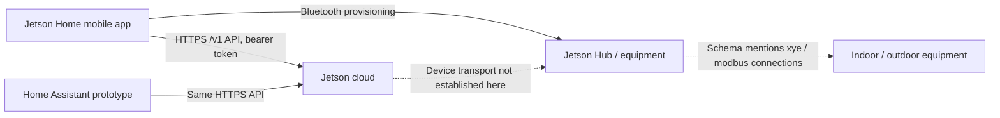

# Unofficial Jetson Home API reference

This reference describes **static evidence from Jetson Home Android 1.2.8**, package `com.jetsonhome.app`, supplemented by authorized live reads on November 3–4, 2026. It is not a vendor specification. Authentication, populated inventory, zone/heat-pump status, air quality, and energy were read successfully. Physical control commands remain untested.

## Evidence and scope

Four evidence levels are kept separate:

| Level | Meaning |
| --- | --- |
| Callsite confirmed | A decoded function constructs the method, URL, and request payload. Live validation is recorded separately. |
| Schema confirmed | A bundled `@jetsonhome/autopilot-api-schema` type defines fields, enums, or validation rules. This alone does not establish a reachable route. |
| Live checked | A user-authorized request reached production. The observed status and response-validation scope are recorded in the endpoint inventory and validation notes. |
| Inferred / unknown | Backend behavior, hardware dependencies, or operational semantics that cannot be established from client code alone. |

The [endpoint inventory](endpoints.md) contains **43 method/path combinations on 33 paths** observed in app HTTP callsites. The [schema catalog](schema-catalog.md) and [JSON definitions](recovered-schemas.json) contain **309 named definitions**, including shared, older, installer, administrative, and unused types. The [OpenAPI document](openapi.json) combines observed routes with matched schemas. Request/response schema associations are reconstructed from names, shapes, and client usage; five response schemas matched earlier live responses. Twelve app operations have an observed HTTP 200 result. Untested operations retain `2XX` rather than an invented exact success code.

The separate [live OpenAPI supplement](live-openapi.json) documents four observed read operations: two newly established routes (energy/current and generic equipment status) and newer fields on zone/heat-pump status. Together the inventories cover **45 distinct method/path combinations**. The supplement preserves differences from the bundled schemas instead of changing the recovered evidence. See [energy](ENERGY.md), [live telemetry and pressure findings](LIVE_TELEMETRY.md), and [validation scope](VALIDATION.md).

## Communication architecture



Production base URL: `https://autopilot-api.jetsonhome.com`.

The bundle also contains `https://autopilot-api.jetson-staging.com`. It was not used. Its existence does not imply that production credentials work there.

Application control uses JSON over HTTPS. The app polls zone status approximately every **10 seconds**. The Home Assistant prototype polls every **30 seconds** by default. No WebSocket/MQTT subscription was found in the traced thermostat control path. Generic WebSocket libraries in the APK are not proof of a device protocol.

From prototype 0.3.0, the Home Assistant schedule separates configuration discovery from measurements. In 0.6.0, normal polls read known zones' `/status` and eligible `/airQuality`, `/v1/systems/{systemId}/energy/current` for systems with an energy monitor, and selected heat-pump units' `/heatpump/status`. Full system/board/equipment/zone discovery runs at startup/reload or when the user selects **Refresh configuration**. The next poll after five minutes also reads `/v1/systems` and configured systems' `/equipment` for connectivity, applying only health/status fields rather than changing the discovered configuration. See [the exact schedule](POLLING.md).

The zone-status query sets `refetchInterval` to `10,000 ms` and `staleTime` to `1,000 ms`. The latter controls cache freshness, not the polling interval. Zone status includes current temperature, configured target, HVAC activity, circulation, and humidity when those features are present. These are active-query settings; they do not establish guaranteed polling while the mobile app is suspended.

Changing the temperature target follows a separate write path with a **500 ms debounce**, grouping rapid adjustments before sending the command. The app also updates its cached/displayed target optimistically and can restore the previous value on failure. A quickly changing display is therefore not proof that hardware has confirmed the new target. The hardware-to-cloud reporting interval and total physical/cloud propagation latency remain unverified. The prototype requests a status refresh after a successful command in addition to its regular polling.

The equipment status schema mentions `xye` and `modbus` connection types, target `idu` or `odu`, connectivity, and an optional address. This establishes vocabulary in the API; it does **not** establish register maps, frame formats, physical pinouts, serial parameters, or a LAN Modbus server.

### Realtime updates: WebSocket, SSE, and MQTT

No usable thermostat push-update channel was identified in this bundle. The confirmed temperature/status read path uses the HTTP polling query described above.

| Clue | Traced use | What it establishes |
| --- | --- | --- |
| `WebSocket` / `WebSocketModule` | React Native's generic runtime implementation and registration | Runtime support, without an identified Jetson thermostat connection or subscription |
| `ws` / `wss` scheme strings | General URL parsing | Recognition of URL schemes, not a server endpoint |
| `EventSource` | Sentry browser API error-monitoring list | Generic monitoring support, not a thermostat event source |
| Native `text/event-stream` string | Expo network-inspector `shouldParseBody` helper | Inspector handling of streaming responses, not an application subscription |
| `mqttEndpoint` / `cmd_set_mqtt` | `EM-001` provisioning schema and monitor provisioning messages | Monitor MQTT configuration; no app/HA subscription or Emporia Vue 3 stream established |

The MQTT schema is specifically `EnergyMonitorEm001Provisioning` with model `EM-001`, an AWS IoT Core data endpoint, and device certificate/key fields. `EMPORIA-VUE-3` appears separately in equipment inventory model enums; that does not establish that it uses the same transport. The provisioning fields suggest a monitor-to-cloud connection, potentially carrying telemetry into Jetson's backend, but packet direction, topics, publish/subscribe permissions, payloads, and consumer access remain unverified. This is not evidence of an inbound-only protocol or a usable Home Assistant power subscription. The explicit `csmsEndpoint` WebSocket reference is in **EV-001 charger OCPP provisioning**, not energy-monitor readings.

No thermostat stream URL, subscription topic, socket authentication handshake, or incoming event schema was established. Static inspection cannot rule out an unpublished backend interface or future firmware support. The native inventory in `analysis/native-realtime-inventory.txt` records the inspected DEX string clues; it is supporting analysis, not proof that every possible dynamic connection is absent.

Commands do not need to wait for the next status poll: they use their HTTP write endpoints, and the prototype requests a refresh afterward. Changes originating in another app or at the thermostat remain dependent on polling plus the equipment's unmeasured cloud-reporting delay.

## Headers and serialization

Authenticated API calls add:

```http
Authorization: Bearer <access-token>
Accept: application/json
Content-Type: application/json
app-version: 1.2.8
X-App-Install-ID: <persistent-install-id>
```

`Content-Type` applies to JSON bodies. The app's API client initializes `app-version` and obtains the bearer token from its auth provider. Auth helper calls use a separate HTTP client and JSON headers; do not assume all authenticated API headers are required there.

**`X-App-Install-ID` is a locally generated installation identifier, separate from the authentication token.** The traced `getOrCreateAppInstallId` function reads the secure-storage key `jetson_app_install_id`; if no value exists, it generates a UUID v4 and stores it for reuse. It does not request this ID from Jetson or derive it from account credentials. The prototype follows the same pattern with its own persistent UUID, so extracting the phone app's ID is unnecessary. Whether the backend makes the header mandatory or associates an authenticated session with a particular ID remains unverified.

The `Authorization` bearer token is different: Jetson issues it through the magic-link exchange below. It cannot be replaced with a made-up UUID. Copying an app access token would provide an expiring credential rather than a durable login; the prototype's sign-in and refresh flow obtains and renews its own server-issued credentials.

All IDs are opaque strings. Use IDs returned by the current account and URL-encode path segments. No pagination or collection filtering was observed in the traced discovery calls; server-side pagination behavior is unknown.

Zod strict-object definitions specify known fields, but callback refinements, transformations, and defaults are not fully representable in plain JSON Schema. `x-refinements`, `x-transform`, `x-local-datetime`, `x-trim`, and `x-runtime-type` retain those qualifications. Examples below are illustrative, not captured responses.

## Authentication

### Request a sign-in email

```http
POST /v1/auth/sign-in/magic-link
```

```json
{"email":"user@example.invalid","appScheme":"jetsonhome"}
```

`appScheme` is optional in `SignInRequest`; the app supplies its deep-link scheme so the email can reopen the requesting build. The response schema is `{"result":"ok"}`. This response is not an access token. The sign-in email must supply the token used in the next request.

Live checks on November 3, 2026: user-authorized requests using the prototype returned HTTP 200 and parseable JSON objects. The user confirmed email receipt, and a supplied token was successfully exchanged; see [validation details](VALIDATION.md#live-endpoint-checks-november-3-2026). The request endpoint's complete response body was not retained or checked against its schema.

### Exchange the email token

```http
POST /v1/auth/verify/magic-link
```

```json
{"email":"user@example.invalid","token":"<one-time-email-token>"}
```

Response fields:

| Field | Type | Meaning |
| --- | --- | --- |
| `userId` | string | Authenticated user identifier |
| `accessToken` | string | Bearer credential for API requests |
| `expiresIn` | number | Access-token lifetime in seconds |
| `refreshToken` | string | Credential for the refresh endpoint |

The token parameter is read from the app's link query parameters. The prototype parses pasted links locally and sends only `email` and `token` to the fixed production API. It never follows the pasted URL. Link lifetime, single-use enforcement, email security-scanner behavior, and session invalidation rules are unknown until tested.

One live exchange returned HTTP 200, matched `VerifyMagicLinkResponse`, and reported `expiresIn: 3600` (one hour). A subsequent authenticated account lookup and empty-system discovery succeeded. This confirms one successful exchange, not the token's expiry or replay policy.

### Refresh

```http
POST /v1/auth/refresh
```

```json
{"refreshToken":"<refresh-token>"}
```

The response contains `accessToken`, `expiresIn`, and **a refresh token to use for the next refresh**. Persist the returned refresh token immediately, whether it changes or remains the same. The prototype serializes refresh operations and persists the returned credentials before subsequent requests. It refreshes shortly before expiry, or once after an authenticated 401. A second 401 surfaces as an authentication failure.

One immediate live refresh returned HTTP 200, matched `RefreshTokenResponse`, supplied a changed access token with `expiresIn: 3600`, and returned the **same refresh token**. An authenticated `/v1/systems` read succeeded with the refreshed credentials. Rotation on every refresh is therefore not established; longer-term expiry, revocation, and multi-session behavior remain unknown.

The app's auth helpers use a 10-second timeout and selected retry logic, including 429/5xx retry eligibility. The prototype uses a 20-second total request timeout and does not automatically replay commands after transport/5xx failures. Whether Jetson refresh tokens are strictly single use or how parallel official-app and HA sessions interact remains unknown.

### Registration and installer auth

`POST /v1/auth/register` sends `email`, `givenName`, `familyName`, and optional `appScheme`; its response is `{"result":"ok"}`. The app has parallel `/v1/install/auth/register` and `/v1/install/auth/sign-in/magic-link` callsites with the same user-registration/sign-in body shapes, and uses the common `/v1/auth/verify/magic-link` exchange.

Do not confuse those auth calls with the bundled `RegisterInstallerRequest` schema, which contains only `email` and appears to describe a different installer-access operation. No route for that schema is claimed here. Installer permissions are not required by the prototype, which uses an ordinary existing homeowner account.

## Discovery and topology

1. `GET /v1/systems` → `{ "systems": [SystemOverview, ...] }`.
2. `GET /v1/systems/{systemId}/zones` → `{ "zones": [Zone, ...] }`.
3. `GET /v1/zones/{zoneId}/status` → `ZoneStatus` directly, **without a `status` envelope**.

`SystemOverview` includes `id`, `name`, optional address, system settings, feature channel, health, and a nullable minimum board firmware version. `health.connectionStatus` may be omitted. Its enum is `Unknown`, `Connected`, or `Disconnected`.

`Zone` contains `id`, `name`, and `equipmentIds`. Zone state is feature-based:

```json
{
  "features": {
    "ambientTemperature": {"...":"temperature state and capabilities"},
    "circulation": {"...":"fan state and capabilities"},
    "humidity": {"...":"humidity state and optional capabilities"}
  },
  "schedule": {"id":"schedule-id","kind":"Weekly","status":"Active"}
}
```

This is a **shape illustration**, not a valid complete response. Each feature and `schedule` can be omitted. A missing feature must not be interpreted as a value of zero or as permission to create controls.

Additional observed reads include system equipment, system boards, current user, system members, and equipment heat-pump health. The heat-pump health response is `{ "health": { "connectionStatus": ..., "operationalStatus": ..., "faults": [...] } }`. Operational status is `Unknown`, `Active`, or `ErrorOther`. Fault structures include categories and optional descriptions/help fields; see the JSON definitions. Field meanings and connectivity staleness differ between schema versions.

Four-ton models appear in families `CDHP-HH1`, `CDHP-HH2`, and `CDHP-AIR1`, among other capacities. The presence of those enum values does not identify which hardware the user will receive or guarantee uniform feature support.

## Temperature and HVAC

### Read fields

Within `features.ambientTemperature`:

| Field | Meaning |
| --- | --- |
| `currentTemperature` | Measured/computed Celsius temperature |
| `currentDisplayTemperatureCelsius` / `currentDisplayTemperatureFahrenheit` | Optional display-rounded values |
| `mode` | Configured HVAC mode |
| `status` | Current operation |
| `settings.mode` | Configured mode in the newer settings object |
| `settings.setpoint.value` | Mode-active/shared Celsius target |
| `settings.setpoint.heatValue` / `coolValue` | Optional paired heat/cool targets |
| `capabilities.setpoint.min` / `max` | Celsius target limits |
| `capabilities.setpoint.precision.celsius` / `fahrenheit` | Allowed temperature step/precision for each unit |

`heatValue` and `coolValue` must be provided together, and the heat value must not exceed the cool value. Those constraints are recorded as refinement annotations in the reconstructed schema.

Older aliases are explicitly deprecated: `current`, `hvacMode`, `hvacStatus`, and `setpoint`. Legacy `setpoint` uses `minValue`, `maxValue`, `precision`, and `increment`. Several deprecated fields remain required in the app's bundled validator. New implementations should prefer the newer fields while allowing compatibility fallbacks where justified.

### Write mode

```http
POST /v1/zones/{zoneId}/hvac/mode
```

```json
{"value":"Heat"}
```

Allowed values: `Off`, `Heat`, `Cool`, `Auto`, `FanOnly`. `Dehumidify` and `Dry` are not in this command enum.

### Write target

```http
POST /v1/zones/{zoneId}/ambientTemperature/setpoint
```

```json
{"value":22.5}
```

The app extracts `celsius` from its internal temperature value and sends a **scalar number**, not a `{celsius:...}` object. API targets remain Celsius regardless of the system's display-unit preference. Use the returned limits and precision.

Mode/setpoint responses are discriminated by `result`:

```json
{"result":"ok"}
```

or

```json
{"result":"unreachable","error":"optional detail"}
```

An HTTP success alone is insufficient to declare the command accepted. Even `result: ok` does not establish physical convergence; poll and compare the reported state.

HVAC operating status enum: `Off`, `Cooling`, `Heating`, `Circulating`, `Dehumidifying`, `Unknown`. Configured mode and current activity are distinct: Heat mode with status Off can mean idle rather than disabled.

A newer `UpdateAmbientTemperatureSettingsRequest` type is bundled, with partial `mode` and `setpoint` settings. No corresponding HTTP callsite was found. **This reference does not invent `/ambientTemperature/settings` or independent heat/cool-target writes.**

## Fan and circulation

```http
PATCH /v1/zones/{zoneId}/circulation/settings
```

Example partial update:

```json
{"fanSpeed":2}
```

Fields:

| Field | Allowed value / unit |
| --- | --- |
| `mode` | `Off`, `Circulate`, `Continuous` |
| `fanSpeed` | `"Auto"`, `1`, `2`, `3` |
| `fanOnDuration` | Integer minutes per hour, 0–60 |
| `enabled` | Deprecated boolean; cannot be sent together with `mode` |

At least one setting is required. The response schema is the full `CirculationSettings` object. The zone's `capabilities.fanSpeedSetting.max` limits numeric settings; don't assume every system has all three speeds. `fanSpeedStatus` is actual level `0`–`3`, with zero allowed only as a reported speed, not a selectable fixed speed.

`Off` disables circulation; `Circulate` uses the configured minutes/hour; `Continuous` requests always-on circulation. These are separate from HVAC `FanOnly` and from airflow while heating/cooling. The app's older `SetCirculationSettingsRequest` uses `enabled`, `fanSpeedSetting`, and `fanOnDurationSetting`; the observed newer PATCH body uses the fields in the table above.

Jetson's public [heat-pump support page](https://jetsonhome.com/us/support/how-heat-pumps-work) says fixed speeds are preferences that may be temporarily adjusted during heating/cooling and that FanOnly requires a fixed speed. Exact command interactions remain a hardware-validation item.

## Humidity

The endpoint, equipment prerequisite evidence, exact UI gating condition, and examples are covered in [HUMIDITY.md](HUMIDITY.md).

The observed request is:

```http
PATCH /v1/zones/{zoneId}/humidity/settings
```

```json
{"mode":"Humidify","setpoint":{"value":45}}
```

Either `mode` or `setpoint` can be updated independently; at least one setting is required. The response schema is the complete settings object. The target is a **relative-humidity percentage**, not a fraction. Actual permitted targets and step size come from the zone's optional humidity capabilities.

## Schedules, presets, and vacation

These routes are documented but are not implemented by the prototype's entities.

Schedule collection: `GET` / `POST /v1/systems/{systemId}/schedules`. Individual schedules use `PATCH` / `DELETE /v1/schedules/{scheduleId}`. Pause/resume use `POST /v1/schedules/{scheduleId}/pause` or `/resume` with `{"kind":"Weekly"}` or `{"kind":"Vacation"}`; omitted kind defaults to Weekly in the schema.

Create-schedule body:

```json
{
  "type":"custom",
  "weekly":[{"day":1,"startTime":"08:00:00","endTime":"17:00:00"}],
  "zones":["zone-id"],
  "enabled":true,
  "name":"Weekday example",
  "preset":"preset-id"
}
```

Day numbers are **1=Monday through 7=Sunday**. `name` and each event's `endTime` are optional. Do not infer overnight-window behavior or DST policy from the time strings. Reads include server-enforced `limits.maxSchedules`. Returned schedule objects have both zone-related fields and an expanded preset; create/update bodies use `zones` and a preset ID. The app strips the internal schedule ID before sending a create/update body.

Preset collection: `GET` / `POST /v1/systems/{systemId}/schedules/presets`. Individual presets use `PATCH` / `DELETE /v1/schedules/presets/{presetId}`. Read responses include `presets`, `capabilities`, and `limits.maxPresets`.

Create preset fields: required `name` and `temperatureSetpoint` (Celsius); optional nullable `temperatureMode`, `fanSpeed`, and `quiet`; optional `isDefaultPreset`. The returned preset uses `isDefault`, which is a different field name. Temperature mode here is `Off`, `Heat`, `Cool`, or `Auto`—the preset temperature-mode enum excludes FanOnly. A 409 branch exists in the preset-upsert error handling; the complete server error contract is unverified.

Vacation: `GET` / `PUT /v1/systems/{systemId}/vacation`. The GET response contains nullable `vacation` plus ambient-temperature capabilities. PUT takes:

```json
{
  "enabled":true,
  "startAt":"2026-12-01T08:00:00",
  "endAt":"2026-12-05T18:00:00",
  "preset":{"temperatureSetpoint":18}
}
```

The schema explicitly requires **system-local datetimes without timezone offsets**, including no `Z` suffix. The example is not a recommended schedule. Do not convert these fields to UTC on the assumption that they are ordinary RFC3339 instants. Disabling vacation uses `enabled: false`; no separate DELETE vacation callsite was found.

Manual HVAC changes may interact with active schedules or vacation state. The client has schedule pause/resume state and optimistic-cache handling, but backend override duration and restoration rules need live testing.

## Settings, members, and claim

- `GET /v1/users/me` returns `{user: ...}`; its PATCH request currently exposes `onboardingCompleted`.
- `PATCH /v1/systems/{systemId}` supports a display name and schema-defined address/settings fields, with admin-only annotations on some fields. Do not assume homeowner tokens can change them.
- System-settings GET returns `{settings: ...}`. Its PATCH body is a partial **flat object**, such as `{"temperatureUnit":"Celsius"}`. Available settings are `temperatureUnit: Celsius|Fahrenheit` and `ambientTemperatureSource: Internal|External`.
- Thermostat-settings GET/PATCH operates on an **equipment ID**, not a zone ID. Fields are `darkModeEnabled`, `idleBrightnessPercent`, and `activeBrightnessPercent`; brightness is an integer 0–100. The PATCH is partial; the response wraps the full settings in `settings`.
- Adding a member uses `{ "member": { "user": { "name": "...", "email": "..." }, "role": "Owner" } }`. Updating uses the system/member path and a partial `member` object. Role enum: Owner or Member. DELETE removes membership. These calls are not needed for routine climate polling or control.
- Claim preview returns a `label`; POST claim sends an empty object and returns `result: ok` or `result: error` with an optional message. The integration does not claim or reassign systems. Actual authorization and transfer rules are unknown.

See the endpoint inventory and per-operation schemas for complete request/response nesting.

## Air quality and schema-only features

Observed routes: `GET /v1/zones/{zoneId}/airQuality` and `GET /v1/airQuality/classification`.

Prototype 0.6.0 presents one HA device per system, with zone-named air-quality readings and equipment-named connectivity diagnostics. Overall classification is an enum; detailed pollutant measurements respect the response's access discriminator and use the schema's ppm/μg/m³/ppb units. The readings retain their zone scope because the response does not identify one physical source sensor. Readings older than one hour, invalid/missing/future timestamps, and settling or missing pollutant values are unavailable; a stopped fan alone does not invalidate recent data. The overall AQ entity's attributes and integration diagnostics expose `access` and the reported missing `jetson_care` entitlement. Missing pollutant entities alone do not establish a subscription restriction. Power and daily-energy sensors now use the confirmed energy/current route. See [the device/entity structure](HA_STRUCTURE.md).

Air-quality responses distinguish `access: full` from `access: limited`. Limited responses specify missing entitlement `jetson_care` and expose only an overall current classification and update time. Full responses add CO2, PM2.5, TVOC, and historical periods. Nullable values indicate missing data. Classification levels are `excellent`, `good`, `fair`, `poor`, and `unhealthy`. Classification metadata supplies unit strings, display ranges, and bands with inclusive minimum/exclusive maximum, with nullable maximum for an open-ended band. Do not invent conversion factors or universal thresholds from enum names.

The bundle also contains historical signal summaries, events/transitions, provisioning, firmware/configuration, heat-strip settings, heat-pump offsets, equipment CRUD, and administrative repair/rollout schemas. **Routes were not established for all of these types.** The energy/current route was subsequently verified by a bounded GET probe, and its keyed live response differs from the bundled response type; see [the energy reference](ENERGY.md). Other schema names alone do not establish routes. API access may depend on hardware, firmware, entitlement, or role.

## Errors and operational unknowns

| Condition | Evidence / prototype behavior |
| --- | --- |
| 401 | App auth interceptors support token renewal; prototype refreshes once and retries the rejected request once. |
| 400/403 on refresh | Treated by the prototype as an expired/revoked sign-in; actual server error mappings remain unverified. |
| 403 on normal resource | Permission failure; prototype does not repeatedly refresh. |
| 409 | Specific preset-upsert error branch exists in the app. |
| 429 | App auth retry logic considers it retryable; prototype pauses using numeric Retry-After or a default. Actual quotas/header formats unknown. |
| 5xx / transport timeout | Command outcome may be ambiguous; prototype surfaces the error without replaying the command. |
| 2xx + `result: unreachable` | Mode/target command failed at the device level. |
| Missing/changed response shape | Prototype reports an update error rather than treating an invalid response as an empty account. |

A shared error JSON schema, exact rate quotas, backoff rules, command idempotency guarantees, session policy, and cloud-to-device latency have not been established. Client error messages do not reproduce response bodies, which can contain account/device details.

## Local control and Bluetooth

Production code contains `disableRetiredLocalNetworkMode` and rejects local-network detection changes outside development builds. The separate “Local” cloud-environment entry has no endpoint in this production bundle and is accompanied by a “start the local API server” developer message. Its availability test requests `<developer-base>/v1/systems` and accepts any HTTP status as reachable. This is not evidence of a LAN device API or unauthenticated control.

The BLE provisioning service is `14ece2f4-558e-5dea-95e3-696631c424f4`. Named endpoints and identifiers include:

| Endpoint | Value |
| --- | --- |
| `proto-ver` | `0x0200` |
| `prov-session` | `0x0201` |
| `prov-scan` | `0x0202` |
| `prov-config` | `0x0203` |
| `prov-ctrl` | `0x0204` |
| `device-identity` | `0x0300` |
| `device-cert` | `0x0301` |
| `device-provision` | `0x0302` |
| `device-ota` | `0x0303` |
| `charger-provision` | `0x0400` |
| `monitor-provision` | `0x0500` |

The characteristic helper substitutes each 16-bit value into the start of the service UUID. Manufacturer advertisement metadata defines pilot company ID `65535`, advertisement version `2`, and device-type bytes JetsonHub=1, EvCharger=2, EnergyMonitor=3. These are static constants; advertising behavior was not captured.

The APK includes Espressif network/session security protobufs and an older `cloud.proto`. The traced newer provisioning schemas include identity, certificate, and device provisioning messages. Some energy-monitor provisioning types mention an AWS IoT MQTT endpoint and certificates; charger provisioning mentions OCPP. Those findings must not be generalized to a heat-pump thermostat MQTT interface. No HVAC read/write BLE commands were established in this investigation. No pairing, Wi-Fi changes, certificates, OTA updates, or device re-provisioning were attempted.

## Reproduction and remaining validation

See [RESEARCH.md](RESEARCH.md) for hashes, tooling, source locations, reconstruction limitations, and [VALIDATION.md](VALIDATION.md) for installation-day checks. The decisive missing evidence is an authenticated response from the user's commissioned equipment and comparison of a few ordinary commands with the official app.
