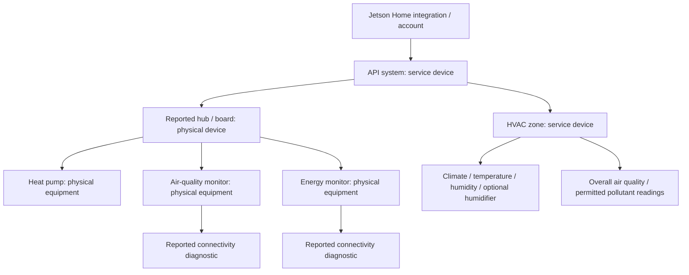

# Home Assistant device and entity structure

Prototype **0.2.0** adds hardware discovery and zone air-quality entities. Live Home Assistant registry behavior and physical-device telemetry remain unverified; the protocol and device-graph logic have automated tests using synthetic fixtures.

## What is registered

One Jetson account creates one Home Assistant integration/config entry. Each API system is a service device. Reported boards/hubs and equipment have distinct device identities; zones are separate service devices for aggregate controls and readings.

This is an example topology. Devices are created from returned inventory, not from assumed hardware. Multiple hubs, monitors, systems, and zones can have distinct identities.

| API object | Home Assistant representation | Stable identifier |
| --- | --- | --- |
| System | Service device, not a fabricated physical hub | `system:{systemId}` |
| Board/hub | Physical device, with reported board type and optional serial | `board:{systemId}:{boardId}` |
| Equipment | Physical device, with reported name/model/optional serial | `equipment:{systemId}:{equipmentId}` |
| HVAC zone | Service device with aggregate controls/readings | `{systemId}:{zoneId}` |

Identifiers use integration domain `jetson_home`. System IDs namespace board/equipment IDs to avoid merging identically named or numbered hardware across systems. Existing zone device and entity unique IDs from 0.1.0 are retained. Display-name changes do not create new device identities. Zone names do not automatically create Home Assistant areas or geographic `zone` entities.

The registry adapter creates device identities before linking them through actual Home Assistant registry IDs (`via_device_id`). Equipment uses its reported `boardId` gateway when that board exists. A reported `parentEquipmentId` is a fallback when the board is unavailable; otherwise the equipment links to the system service device. Self-parenting and cycles are removed from the device plan. Zone aggregate devices link to the system because one zone can involve multiple pieces of hardware.

Reported equipment belongs in a normal registry device: it has its own hardware ID, model, and possibly serial number. It is not represented as a Home Assistant child device for a nameless internal component. The design follows the distinction in the [Home Assistant device registry documentation](https://developers.home-assistant.io/docs/device_registry_index/).

## Entities and units

| Entity | Device grouping | HA device class / state class / unit |
| --- | --- | --- |
| Climate control | Zone service device | Climate platform, Celsius internally |
| Current temperature | Zone service device | Temperature / measurement / °C |
| Current relative humidity | Zone service device | Humidity / measurement / % |
| Optional humidifier control | Zone service device | Humidifier platform; enabled only by advertised capability |
| Overall air-quality level | Zone service device | Enum; excellent, good, fair, poor, unhealthy |
| CO₂ | Zone service device | CO₂ / measurement / ppm |
| PM2.5 | Zone service device | PM2.5 / measurement / μg/m³ |
| TVOC | Zone service device | VOC parts / measurement / ppb |
| Equipment connection | Respective physical equipment device | Connectivity binary sensor; diagnostic |

The air-quality API is `GET /v1/zones/{zoneId}/airQuality`. It has no physical source-equipment ID, so measurements are not attributed to one particular return-air sensor or copied to every installed monitor. Hardware identity and zone-level measurements are both preserved, with different scopes.

The poller identifies associated `Sensor` equipment with model `TEMCO-AQM` using `zoneIds` or the zone's `equipmentIds`. When a peripheral has no explicit zone assignment, its reported parent equipment can establish which zone endpoint to read. An explicit assignment to another zone is not overridden. This is discovery logic for the zone read; it is not proof that that physical monitor is the sole source of the aggregate value.

The units are explicit in the recovered app schemas: CO₂ in ppm, PM2.5 in μg/m³, and TVOC in ppb. TVOC therefore uses Home Assistant's **VOC parts** device class, not its mass-concentration class. The categorical overall level is an enum, not a numeric AQI. The numeric sensors use `measurement`, consistent with [Home Assistant's sensor definitions](https://developers.home-assistant.io/docs/core/entity/sensor/).

## Optional equipment and access

The server's `access` discriminator controls air-quality entities:

- `full`: overall level and CO₂/PM2.5/TVOC sensors can be created, with null measurements reported as unknown.
- `limited`: only the overall classification is exposed. The app's schema identifies missing entitlement `jetson_care`.
- Failed/unexpected air-quality response: affected air-quality entities are unavailable, while climate polling can continue.

If full access is later withdrawn, existing numeric entities become unavailable and do not retain/expose their old readings as current. If access is granted later, newly permitted entities are discovered. No historical measurements are imported into Home Assistant statistics by this implementation.

Equipment-connectivity entities are created only when inventory reports a connection-status field. Connected maps to on, Disconnected to off, and Unknown to an unknown state. This is the backend's liveness assessment, not a direct local ping. The app's equipment schema describes a five-minute staleness window, so connectivity should not be interpreted as instantaneous.

Inventory and air-quality endpoints are optional for climate operation. On a transient inventory error, the last successful topology is retained, connectivity measurements from that inventory become unavailable, and climate updates continue. From 0.3.0, new hardware, renamed devices, gateway links, and zone memberships are applied at startup/reload or through **Refresh configuration** in the options menu. Routine measurements do not discover configuration. A separate connectivity check runs on the next poll after five minutes and updates only known objects' liveness. Equipment omitted from a successful health read becomes unknown until configuration is refreshed; a refreshed configuration that removes it makes its existing entities unavailable. This prototype retains registry records rather than automatically deleting device-linked automations. See [polling behavior](POLLING.md).

## Energy: hardware discovery is implemented; telemetry is not

The integration recognizes reported `EnergyMonitor` equipment, including schema models `EM-001` and `EMPORIA-VUE-3`, and registers its gateway link and supplied metadata. It can expose its reported connection status.

The recovered AWS IoT MQTT provisioning schema is explicitly for `EM-001`. It does not establish the transport used by `EMPORIA-VUE-3`, readable telemetry topics, or a Home Assistant subscription. The explicit OCPP WebSocket provisioning field belongs to the EV charger. See [the transport findings](API.md#realtime-updates-websocket-sse-and-mqtt).

It **does not create power, energy-consumption, or Energy-dashboard entities yet**. The bundle defines the following fields, but no verified read callsite was found for their response type:

| Recovered field | Intended future mapping once the route is established |
| --- | --- |
| `live.totalMainPowerW` | Whole-home aggregate power, W, measurement |
| `live.loads[].powerW` with `equipmentId` | Equipment-specific power linked to that equipment's device |
| `today.totalMainEnergyKwh` | Whole-home energy counter, kWh, with reset/statistics behavior confirmed before use |

A whole-home total should be exposed once at its aggregate scope, not duplicated onto every physical meter or counted as both whole-home and equipment consumption without context. Per-load readings can be attached to physical equipment only when the returned equipment ID identifies the load.

Home Assistant's Energy dashboard needs a valid energy sensor and appropriate statistics. Power is a measurement; cumulative energy needs an energy device class and a suitable `total`/`total_increasing` state class. The app's “today” schema suggests a daily accumulating counter, but its resets, corrections, timezone, and data freshness still need verification. This prototype does not fabricate zero readings, choose an unobserved energy route, or make an unavailable monitor look Energy-dashboard ready.

## Validation scope

The expanded tests cover discovered hardware/zone relationships, multiple-system identity separation, parent fallbacks/cycles, access-limited pollutant handling, null versus zero, optional endpoint failures, and the absence of invented energy requests. They exercise the pure device plan and HTTP protocol, not a live Home Assistant registry. The final integration still needs a runtime test and comparison against the user's commissioned hub, monitors, and account permissions.
