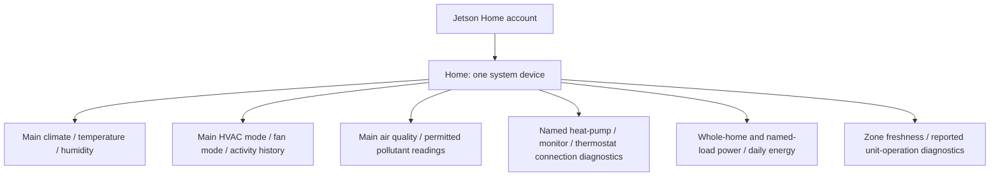

# Home Assistant device and entity structure

Version **0.4.0** groups a Jetson installation into **one HA device per API system**. All zone controls/readings and named equipment diagnostics belong to that system device. Multiple systems remain separate, including when one account can access several homes.

## Grouping

The system device uses identifier `system:{systemId}` in domain `jetson_home`, the reported system name, and model Jetson Home. It is an aggregate service device; the integration does not assign one piece of equipment's serial number to the whole installation. Hubs, equipment IDs, gateway links, models, and zone membership remain in the discovered API configuration. Equipment model/type/role/connectivity summaries are included in redacted diagnostics, while serial numbers, account identifiers, equipment names, and addresses are omitted from that export.

No extra HA device rows are created for the hub, indoor/outdoor unit, air-quality monitor, energy monitor, thermostat, or zones. Entity names identify their zone or equipment: Main Temperature, Main Fan mode, Return Sensor connection, Energy Monitor connection. Zone names do not create geographic HA zone entities or automatically assign areas.

## Existing-install migration

The earlier releases created separate system, board, equipment, and zone device records. On the first successful startup/reload or Refresh configuration with 0.4.0:

1. Reuse the existing system device when present, or create it.
2. Move this entry's existing Jetson entities from recognized legacy devices to the system device, including disabled and unavailable records.
3. Keep entity IDs, unique IDs, custom names, options, and explicit area assignments. An area inherited from an old device is made explicit on the entity. An entity disabled through an old device stays disabled when its new system device is enabled.
4. Remove each recognized old device only after it has no remaining entities or child components. Unrecognized records, other entries, and devices still owning unrelated entities are left alone.

This preserves entity-based references and their existing history/statistics identifiers. **Automations or scripts referring directly to removed device IDs must have the system device selected again.** The migration does not rewrite user automations. Device-specific names, labels, and device targets are not merged into a single universal identity; the system device's own settings remain its settings. Review any device-level customization previously applied to individual equipment.

The system device ID is retained when its prior record exists. Migration is idempotent and scoped to the account entry; entities are not deleted or recreated simply to change their grouping. Systems no longer returned by discovery are not arbitrarily merged into another home.

## Entities and units

| Entity | Grouping on system device | HA device class / state class / unit |
| --- | --- | --- |
| Climate control | One named climate entity per zone | Climate platform, Celsius internally |
| Current temperature | Zone-named sensor | Temperature / measurement / °C |
| Current relative humidity | Zone-named sensor | Humidity / measurement / % |
| HVAC mode / Fan mode / HVAC activity | Zone-named history sensors | Enum, read-only; see [history](HISTORY.md) |
| Optional humidifier control | Zone-named control | Enabled only by advertised capability |
| Overall air-quality level | Zone-named sensor | Enum: excellent, good, fair, poor, unhealthy |
| CO₂ | Zone-named sensor | CO₂ / measurement / ppm |
| PM2.5 | Zone-named sensor | PM2.5 / measurement / μg/m³ |
| TVOC | Zone-named sensor | VOC parts / measurement / ppb |
| Equipment connection | Equipment-named diagnostic | Connectivity binary sensor |
| Zone connection / issues | Zone-named diagnostic; issues and issue count are attributes | Connectivity binary sensor |
| Telemetry status / Last device reading | Zone-named diagnostics | Plain text / timestamp |
| Heat-pump operation fields | Equipment-named diagnostics; only reported fields appear | Text or dimensionless number; no invented RPM/% units |
| Whole-home / per-load power | System or reported load name | Power / measurement / W |
| Whole-home / per-load energy today | System or reported load name | Energy / total with explicit local-midnight reset / kWh |

The air-quality endpoint is `GET /v1/zones/{zoneId}/airQuality`. It has no physical source-equipment ID. Consolidating the UI does not change that scope: each zone aggregate is exposed once, rather than being attributed to a particular return-air monitor or copied to every installed monitor. The poller associates reported Sensor/TEMCO-AQM equipment using explicit zone/equipment membership or a parent's zone membership when the peripheral has none. An explicit assignment to a different zone is not overridden.

The app's schemas establish ppm for CO₂, μg/m³ for PM2.5, and ppb for TVOC. TVOC uses HA's VOC parts device class; the categorical overall value is an enum, not a fabricated numeric AQI.

## Missing air-quality measurements and access

The server response controls available entities:

- `access: full`: overall quality plus CO₂/PM2.5/TVOC sensors; missing/settling pollutant values are unavailable.
- `access: limited`: overall quality only; the recovered schema identifies missing entitlement `jetson_care`.
- Failed/unexpected response: affected AQ readings unavailable; climate polling can continue.

Missing pollutant entities by themselves do not confirm a subscription problem. They can also mean there is no associated AQM, the AQ request failed, or the configuration needs refreshing. The overall AQ sensor now exposes an `access` attribute and, when reported, `missing_entitlement: jetson_care`. Downloaded integration diagnostics contain `air_quality_available`, `air_quality_access`, `air_quality_missing_entitlement`, and `air_quality_request_failed` per anonymized zone. These distinguish access restrictions from a failed read without exporting credentials or account/device identifiers.

If access changes from limited to full, pollutant entities can appear automatically on a normal poll. Losing full access makes existing pollutant entities unavailable. The integration neither supplies artificial values nor imports historical readings.

## Connectivity and configuration updates

Connected maps to on, Disconnected to off, and Unknown to an unknown diagnostic state. Connectivity is the backend's liveness assessment, not a direct local ping. The newer zone-status connection field takes priority over cached system health and is read each measurement cycle. Zone connection diagnostics also expose reported issues. Telemetry status and Last device reading distinguish a successful API request from a recent device sample. Inventory connection checks run on the next poll after five minutes and update only known objects' status; the backend also describes a five-minute equipment staleness window. Configuration changes are applied at startup/reload or through Refresh configuration. See [polling](POLLING.md).

Inventory errors retain last-good optional data and make affected connectivity readings unavailable. Equipment omitted from a successful health read becomes unknown until explicit discovery. Removing equipment from the active configuration makes its existing entities unavailable; the initial consolidation cleanup is distinct from deleting historical entity records.

## Power and daily energy

Version 0.5.0 reads `GET /v1/systems/{systemId}/energy/current` once per system with a discovered EnergyMonitor. The confirmed response supplies whole-home power and daily energy, plus named load values keyed by reported load identifiers. All sensors share the system device. Null/missing values remain unknown; optional request failures and stale timestamps make the readings unavailable.

Daily energy uses HA's `total` state class with an explicit reset derived from the API's date and IANA timezone. This accommodates within-day corrections; a calendar-day reset was observed live across local midnight. Per-load identities use reported keys rather than guessing from names. The whole-home total is exposed once; load totals, residuals, and unverified heat-strip components are not added to it. Whole-home and per-load energy can serve different Energy-dashboard roles, so avoid configuring overlapping readings as independent home consumption sources. Recorder/Energy behavior still needs validation in HA. See [energy details](ENERGY.md).

The AWS IoT MQTT provisioning schema is specifically for EM-001. It does not establish a readable Emporia Vue 3 stream or subscription. The explicit OCPP WebSocket field belongs to the EV charger; see [transport findings](API.md#realtime-updates-websocket-sse-and-mqtt).

## Validation scope

Protocol/polling tests use a local mock server. Consolidation tests use in-memory registry adapters, covering stable entity IDs, disabled entities, inherited areas, account/system isolation, repeated migration, and keeping records with unrelated entities or child components. A user screenshot confirms the earlier per-equipment layout loaded in HA. The combined layout, migration in a real registry, Recorder history, and physical control behavior still need live testing.

## Air-quality freshness

Air-quality entities become unavailable when `current.lastUpdatedAt` is more than one hour old, matching the Android app threshold (`isReadingStale`, recovered bundle lines 1015152–1015235). A recent reading remains available when the fan stops; availability returns on a fresh sample. Missing, invalid, timezone-less, or future timestamps are treated as unavailable. Individual pollutants are also unavailable while settling or when their value is missing. Climate and room temperature/humidity remain independent. This is evaluated at each normal polling update.
